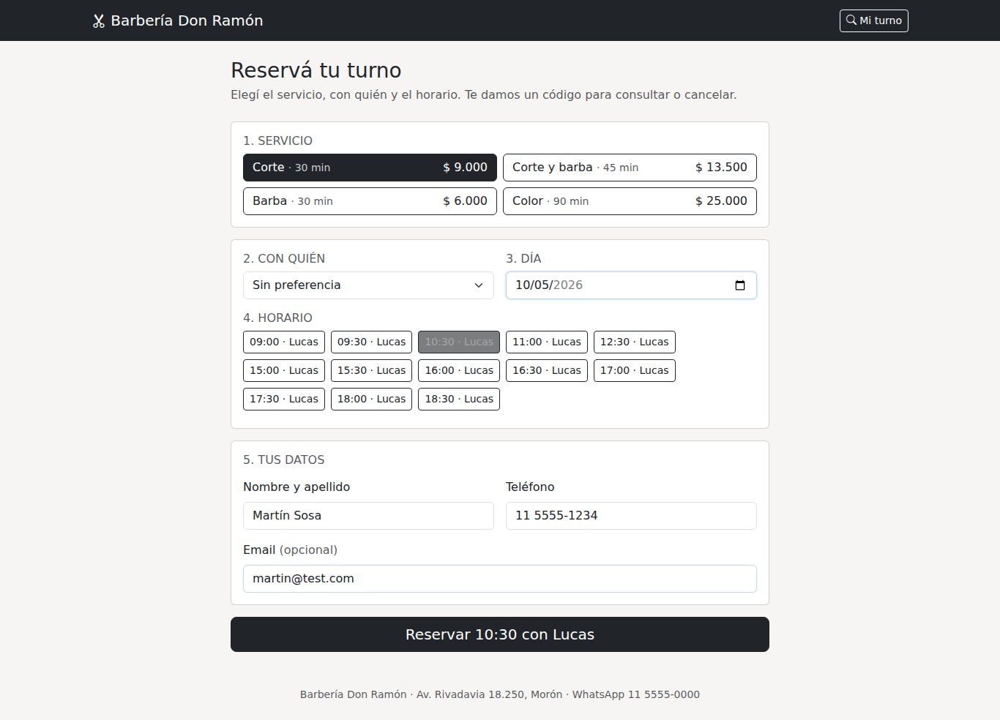
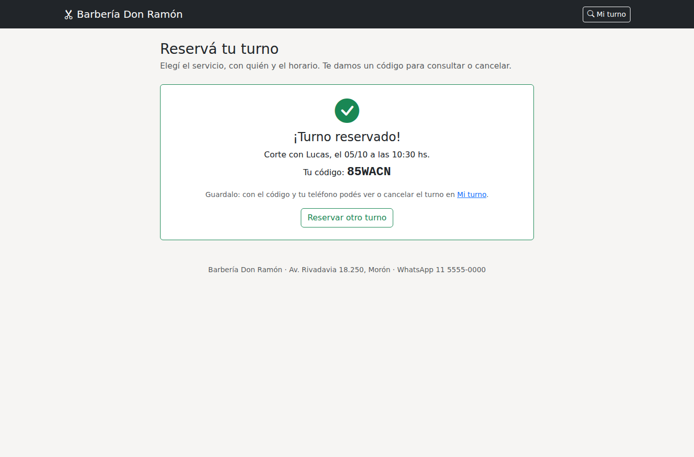
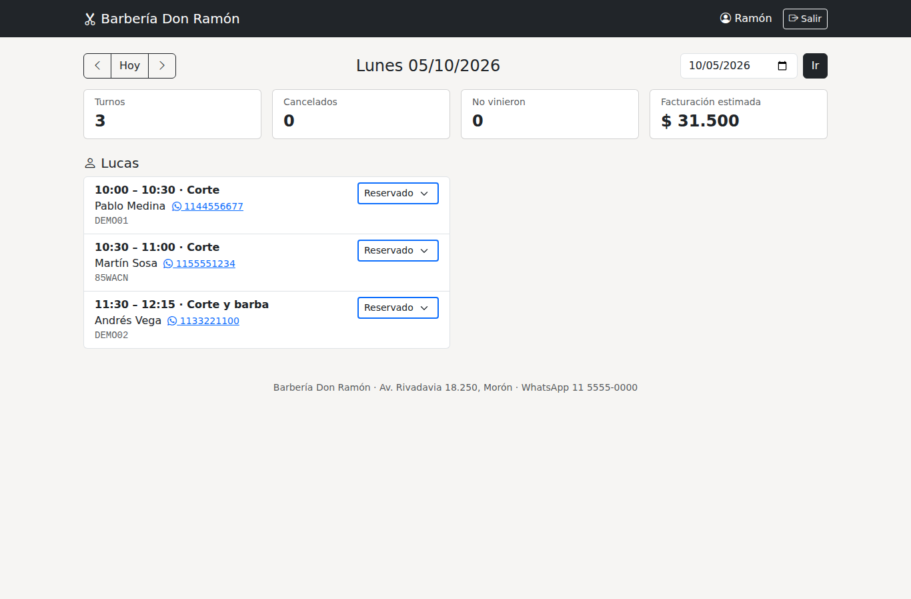

# Agenda de turnos online

🇬🇧 [Read in English](README.en.md)

Sistema de reserva de turnos para negocios de servicios (la demo es una barbería), hecho en **PHP sin frameworks** (compatible con PHP 5.6 a 8.x), **MySQL**, **Bootstrap 5**, **jQuery** y **Ajax**.

## Funcionalidades
**Para el cliente**
- Reserva en una sola pantalla: servicio, profesional (o "sin preferencia"), día y horario. Los horarios libres se cargan por Ajax cada vez que cambia una opción, sin recargar.
- Solo se ofrecen horarios **realmente libres**: dentro del horario de atención, sin superponerse con otros turnos y con al menos 1 hora de anticipación.
- Al confirmar recibe un **código de turno** de 6 caracteres.
- **Mi turno:** con el código y el teléfono ve el turno y lo cancela solo, hasta 2 horas antes.

**Para el negocio (panel con login)**
- Agenda del día agrupada por profesional, con navegación por días.
- Cambio de estado por Ajax: reservado, asistió, no vino o cancelado.
- Resumen del día: turnos, cancelados, ausentes y facturación estimada.
- Link directo al WhatsApp de cada cliente.

## Cómo se calculan los horarios libres
Cada profesional tiene **bloques de atención semanales** (tabla `horarios`; puede tener mañana y tarde). Para un servicio y un día, `horarios_disponibles()`:
1. Recorre cada bloque en pasos de 30 minutos (`SLOT_MINUTOS`).
2. Descarta los horarios en los que el servicio **no termina dentro del bloque** (un color de 90 minutos no puede empezar a las 12:00 si el bloque cierra a las 13:00).
3. Descarta los que **se superponen** con un turno no cancelado. Dos rangos se superponen si cada uno empieza antes de que termine el otro: `inicio_a < fin_b AND fin_a > inicio_b`.
4. Descarta los que no respetan la anticipación mínima.
5. Con "sin preferencia", para cada hora asigna al primer profesional libre.

## Decisiones de diseño
| Decisión | Por qué |
|---|---|
| Al reservar se vuelve a calcular la disponibilidad dentro de una transacción, con la fila del profesional bloqueada | Si dos personas eligen el mismo horario a la vez, solo una lo consigue; la otra ve "Ese horario ya no está disponible" y la lista se actualiza sola. |
| El turno guarda `inicio` y `fin` | Cambiar después la duración de un servicio no altera los turnos ya dados, y detectar superposiciones es una comparación simple. |
| Código de 6 caracteres sin `0/O` ni `1/I` | Fácil de dictar por teléfono y difícil de adivinar (32⁶ ≈ mil millones de combinaciones). |
| Consultar o cancelar pide código **y** teléfono, con límite de intentos | Con solo el código alguien podría probar códigos al azar y cancelar turnos ajenos. |
| Teléfono guardado solo con dígitos | El cliente lo puede escribir como quiera (`11 5555-1234`, `(11) 5555 1234`) y la búsqueda igual funciona. |
| Reglas en constantes (`SLOT_MINUTOS`, `MINUTOS_ANTICIPACION`, `DIAS_MAXIMOS`, `HORAS_CANCELACION`) | Cada negocio las ajusta en `includes/config.php` sin tocar la lógica. |

## Seguridad
| Riesgo | Cómo se resuelve |
|---|---|
| Inyección SQL | Todas las consultas son preparadas con PDO. |
| XSS | Toda salida pasa por `htmlspecialchars`; el JavaScript arma los botones de horario con `.text()`. |
| CSRF | Token por sesión en los formularios y en cada pedido Ajax. |
| Reservas en masa | Máximo 3 reservas por hora desde la misma sesión. |
| Panel | Login con `password_hash`, regeneración de sesión y bloqueo después de 5 intentos; los endpoints del panel responden 401 en JSON sin sesión. |
| Archivos internos | `.htaccess` deniega `includes/`, `data/`, `sql/` y `tests/`. |

## Casos de uso documentados
| # | Caso | Resultado esperado |
|---|---|---|
| 1 | Elegir Color (90 min) con Lucas un lunes | El último horario ofrecido a la mañana es 11:30 y a la tarde 17:30. |
| 2 | Elegir "sin preferencia" un martes | Aparecen horarios de 9:00 a 18:30 sin huecos; al mediodía los toma Martina. |
| 3 | Dos personas reservan el mismo horario | La primera recibe el código; la segunda, "Ese horario ya no está disponible" y la lista actualizada. |
| 4 | Reservar a las 9:30 un servicio de 45 min cuando hay un turno a las 10:00 | Las 9:30 no se ofrecen; las 9:00 y las 10:30 sí. |
| 5 | Cancelar desde "Mi turno" faltando 1 h 30 min | No se cancela; indica escribir por WhatsApp. |
| 6 | Cancelar faltando 2 horas o más | Se cancela y el horario vuelve a quedar libre. |
| 7 | Buscar el turno con el teléfono escrito distinto | Lo encuentra igual. |
| 8 | El negocio marca "asistió" en el panel | Cambia sin recargar y se actualiza la facturación del día al volver a cargar. |

Los casos 1 a 7 están automatizados en `tests/pruebas.php` (26 pruebas), con una fecha fija para que no dependan del día en que se corren.

## Estructura
```
index.php            Reserva (público)
mi-turno.php         Consulta y cancelación (público)
agenda.php           Agenda del día (panel)
login.php / logout.php
api/horarios.php     Horarios libres (JSON)
api/reservar.php     Confirmar reserva (JSON)
api/estado.php       Cambiar estado de un turno (JSON, panel)
includes/
  config.php         Datos del negocio, reglas de la agenda y base de datos
  db.php             Conexión PDO (MySQL, o SQLite en modo demo)
  funciones.php      Sesión, CSRF, JSON, mensajes
  turnos.php         Disponibilidad, reservas, cancelaciones y estados
  layout.php         Encabezado y pie comunes
assets/js/           reserva.js, panel.js, general.js
sql/schema.sql       Tablas MySQL y datos iniciales
sql/crear_usuario.php  Alta de usuarios del panel desde consola
tests/pruebas.php    Pruebas sin dependencias
```

## Cómo correrlo
**Local (modo demo, sin instalar MySQL):**
```bash
php -S localhost:8000
```
Reservas en `http://localhost:8000`, panel en `http://localhost:8000/agenda.php` con `admin` / `admin1234`. Se crea `data/demo.sqlite` con turnos de ejemplo para los próximos días.

**Pruebas:**
```bash
php tests/pruebas.php
```

**Servidor con MySQL (ej. InfinityFree):**
1. Ejecutar `sql/schema.sql` en phpMyAdmin y ajustar profesionales, servicios y horarios.
2. Copiar `includes/config.local.ejemplo.php` como `includes/config.local.php` y completar los datos.
3. Crear el usuario del panel: `php sql/crear_usuario.php admin <contraseña> "Nombre"`.
4. Cambiar nombre, dirección y WhatsApp del negocio en `includes/config.php` y subir los archivos a `htdocs/`.

Requiere PHP 5.6 o superior con PDO (`pdo_mysql`, o `pdo_sqlite` para el modo demo).

## Capturas
| Reserva | Confirmación | Agenda del día |
|---|---|---|
|  |  |  |
